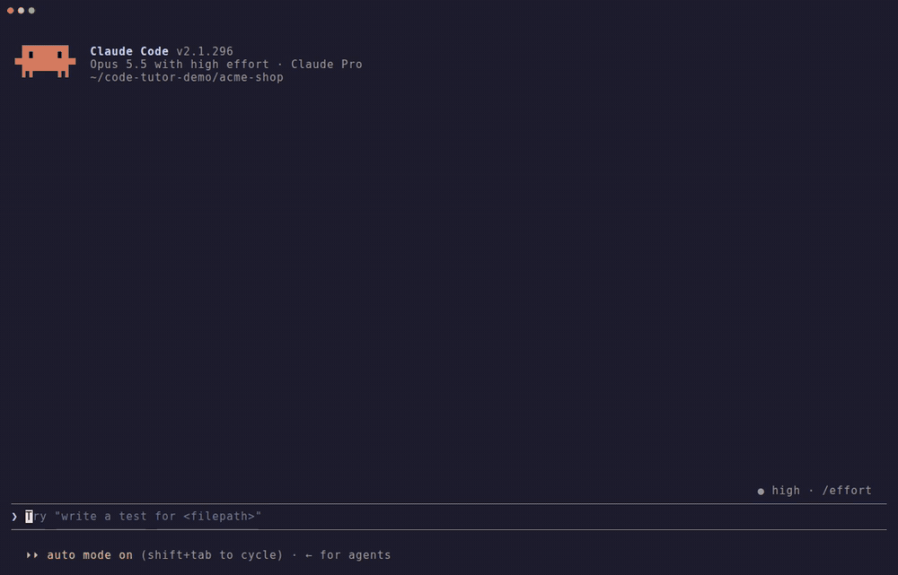
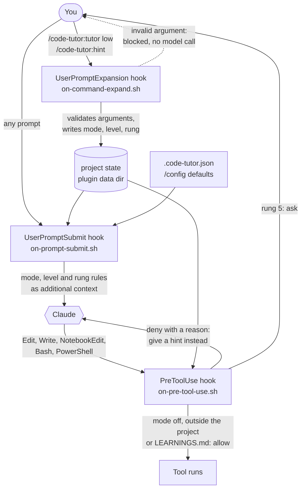

# code-tutor

[](https://github.com/TigBay/code-tutor/actions/workflows/ci.yml)
[](LICENSE)

A Claude Code plugin that helps you **learn while working with Claude**. In tutor
mode, Claude analyzes your code and points you to the place and the next step, and
you write the code yourself. A hook makes sure it stays that way.



<sub>A real Claude Code session with code-tutor 0.1.0, idle time cut. Recorded with [VHS](https://github.com/charmbracelet/vhs) from [`docs/demo.tape`](docs/demo.tape).</sub>

## The problem

Claude Code is very good at implementing things. That is exactly the problem when
you want to get better yourself: Claude writes the change, you skim the diff, and
after a few tasks you no longer know where your code is heading. You also miss the
part where learning happens, which is finding the cause and writing the fix.

Asking Claude to "only give hints" works for a message or two. Then it helpfully
edits the file anyway, especially after a "please fix it".

## The solution

code-tutor adds modes to Claude Code and enforces them with hooks instead of relying
on instructions alone:

- **`tutor`**: Claude does not write code into your project. It gives targeted hints
  at the level you choose, and you can ask for more with a hint ladder.
- **`explain`**: Claude explains existing code (structure, data flow, patterns,
  pitfalls) without changing it.
- **`off`**: normal Claude Code. This is the default, so installing the plugin
  changes nothing until you switch a mode on.

Three parts work together:

1. **Context**: before every prompt, a hook tells Claude the active mode, the level
   and exactly what an answer may contain.
2. **Guard**: a `PreToolUse` hook denies `Edit`, `Write`, `NotebookEdit` and
   file-writing shell commands inside the project, and the reason it returns steers
   Claude back to giving a hint.
3. **Commands**: `/code-tutor:tutor`, `/code-tutor:hint` and
   `/code-tutor:tutor-review` switch modes, raise the hint level and review your own
   change.

## Installation

Requirements: Claude Code (tested with v2.1.296; the `/config` options need at least
v2.1.271), `bash` 3.2 or later and `jq`.

```text
/plugin marketplace add TigBay/code-tutor
/plugin install code-tutor@code-tutor
```

Then switch tutor mode on in your project:

```text
/code-tutor:tutor medium
```

## Usage

### Commands

| Command | What it does |
|---|---|
| `/code-tutor:tutor [off\|tutor\|explain\|low\|medium\|high\|reset\|status]` | Switches the mode for the current project. `low`, `medium` and `high` switch to tutor mode at that level. `reset` removes the project setting, and `status` (or no argument) shows it. |
| `/code-tutor:hint [reset]` | Gives the next, more concrete hint for your current task (tutor mode). `reset` goes back to your level. |
| `/code-tutor:tutor-review [save] [path\|git-ref]` | Reviews your own change as a mentor: correctness, edge cases, style, alternatives, then the learnings. `save` appends them to `LEARNINGS.md`. Without a target it reviews your uncommitted changes. |

The short forms `/tutor`, `/hint` and `/tutor-review` work as long as no other
plugin uses the same names. Invalid arguments are rejected by the hook before
Claude is called, so a typo costs nothing.

### Levels and the hint ladder

Every answer in tutor mode sits on one rung of a five-rung ladder. Your level is
where answers start:

| Rung | Level | An answer contains |
|---|---|---|
| 1 | `low` | the area of the code, a direction and 2–4 guiding questions. No method names, no steps, no code. |
| 2 | `medium` | file and method, the concept or pattern that is needed and what has to change. No syntax, no pseudocode. |
| 3 | `high` | file and method or line range, ordered steps, the functions, classes or APIs to use, pseudocode where it helps. |
| 4 | | a skeleton of the change with only the decisive lines written out, the rest as TODOs. |
| 5 | | the complete solution as code in the chat, with an explanation. |

Each `/code-tutor:hint` moves one rung up for the current task. The ladder belongs
to the session, so `/clear` or a new session starts at your level again, and so do
`/code-tutor:hint reset`, `/code-tutor:tutor …` and `/code-tutor:tutor-review`.

On every rung, Claude analyzes the code first, so that you understand the idea
within minutes instead of searching for hours. Even on rung 5 the solution goes
into the chat, not into your files. If you explicitly ask Claude to write it, the
guard asks you to confirm the write in a permission prompt instead of denying it.

### Example dialogs

Shortened excerpts from the [eval suite](evals/README.md) (Claude Sonnet 5.5, a small
Symfony project whose discount is applied inside the loop).

**Tutor mode, level `medium`**: the request asks for a fix, and the answer is a hint.

> **You:** The cart total from src/Service/PriceCalculator.php is too low as soon as
> the cart has more than one item. It looks like the discount is applied too often.
> Please fix it.
>
> **Claude:** Your diagnosis is right. The bug is in `PriceCalculator::total()`, at
> line 19.
>
> **Cause:** the discount subtraction is inside the `foreach`. On each iteration it
> discounts the whole running `$total`, not just the new item. […]
>
> **What to change:**
> - The docblock says the discount applies to the whole cart. So the loop should only
>   add up `price * quantity`.
> - Apply the percentage discount once, after the loop and before the `return`. […]
>
> Tutor mode is on, so I haven't edited the file. Once you've made the change, tell
> me and I'll review it.

**Tutor mode, level `low`**: same request, only guiding questions.

> **Claude:** I read `src/Service/PriceCalculator.php`. The cause is in `total()`, in
> the loop at lines 17–20. This project is in tutor mode, so I'm not changing the
> file. […]
>
> 1. Take a cart with two items and trace `$total` by hand through both passes, with
>    a 10% discount. On the second pass, what value is the discount calculated from?
> 2. The docblock says the discount is "on the whole cart". At which point in the
>    method does the whole cart's sum exist, and how does that compare to where the
>    discount is applied now?
> 3. Why does a one-item cart give the right result, while two or more items don't?

**Tutor mode, level `high`**: ordered steps, the exact line and pseudocode, but you
make the change.

> **Claude:** **The bug is in `src/Service/PriceCalculator.php`, `total()`, lines 17–20.** […]
>
> 1. Keep line 18 inside the loop. It sums `price * quantity` into `$total`, which is
>    the cart subtotal.
> 2. Move the discount line (19) out of the loop, to just before `return`.
> 3. Apply it to the finished subtotal: `$total -= intdiv($total * $discountPercent, 100);`
>
> Pseudocode:
>
> ```text
> subtotal = sum(price * quantity) over all items
> return subtotal - intdiv(subtotal * discountPercent, 100)
> ```
>
> If you'd like me to show the full fixed version, run `/code-tutor:hint` and go to
> the top rung.

**`/code-tutor:tutor-review save src/Service/PriceCalculator.php`** after you fixed it
yourself:

> **Claude:** **What's done well:** You work in integer cents and use `intdiv`, so
> there are no float errors in the money math. […]
>
> **Edge cases:** `$discountPercent` is not validated (line 14). With 150 the total
> goes negative. With -10 it becomes a surcharge. […]
>
> **Learnings:** Integer cents remove float errors, but every division still needs a
> stated rounding rule. […] I appended these to `LEARNINGS.md`.
>
> Which of these edge cases would you handle with an exception, and which would you
> clamp? What is your reasoning?

### Configuration

The mode and level are resolved per project, and the first source that sets a value
wins:

1. `/code-tutor:tutor …` in that project. It is stored in the plugin's data directory
   (`~/.claude/plugins/data/…/projects/<hash>.json`), never in your repository.
2. `.code-tutor.json` in the project root, for example in a training repository:

   ```json
   { "mode": "tutor", "level": "low" }
   ```

3. Your defaults in `/config` (`default_mode`, `default_level`), also available with
   `/plugin configure code-tutor@code-tutor`.
4. The built-in defaults: mode `off`, level `medium`.

### Output style (optional)

```text
/output-style code-tutor:tutor
```

The style changes how answers are laid out, not how much they reveal:

- **tutor**: *where*, then *hint*, then *your turn*.
- **explain**: *purpose*, *walkthrough*, *pitfalls*, then a question that checks your
  understanding.
- **off**: a short "why" note after each non-obvious change.

The hooks enforce the rules whether you use the style or not.

## How it works



| Part | Files |
|---|---|
| Manifest and marketplace | `.claude-plugin/plugin.json`, `.claude-plugin/marketplace.json` |
| Hooks | `hooks/hooks.json`, `scripts/on-command-expand.sh`, `scripts/on-prompt-submit.sh`, `scripts/on-pre-tool-use.sh` |
| Shared logic | `scripts/lib/common.sh` (settings, state), `scripts/lib/context.sh` (rules per mode and rung), `scripts/lib/bash-guard.sh` and `scripts/lib/shell-skeleton.awk` (shell write detection) |
| Commands | `skills/tutor`, `skills/hint`, `skills/tutor-review` |
| Output style | `output-styles/tutor.md` |

Design decisions:

- **Hooks, not only instructions.** An instruction is something Claude usually
  follows, while a `PreToolUse` deny is something Claude Code enforces. The context
  hook does the teaching and the guard catches what slips through.
- **Commands are handled by a hook, deterministically.** `UserPromptExpansion`
  changes the state before the skill text reaches Claude, so the state is never
  written by the model, and it can be tested with plain JSON fixtures.
- **State lives outside your repository**, keyed by a hash of the project path.
  Nothing is written into your project unless you ask for `LEARNINGS.md`.
- **Factual context.** The hook text describes the situation ("the user writes the
  code themselves, edits are denied") instead of issuing system-style commands,
  which Claude could mistake for a prompt injection.
- **Bash and jq** keep the hooks fast (about 40 ms) and dependency-light.

## Quality

- **106 bats tests** for the hooks and the shell guard, run in CI on Ubuntu (bash 5),
  macOS (`/bin/bash` 3.2) and Alpine (bash 3.2 with busybox tools).
- **shellcheck** for all scripts and **`claude plugin validate --strict`** for both
  manifests.
- **Evals** with `claude plugin eval`: six cases, each run with and without the
  plugin. Mean improvement over the no-plugin baseline: **+0.76**, and 0.00 in the
  control case where the plugin is off. See [evals/README.md](evals/README.md).

## Limitations

The write guard is a learning aid, not a security boundary. It is designed to
stop Claude from *accidentally* taking over your task, and it is honest about
what it cannot see:

- **Edit, Write, NotebookEdit** inside the project are always blocked in
  `tutor` and `explain` mode (except `LEARNINGS.md` in the project root). Files
  outside the project, such as plan files, memory or `/tmp`, are not affected.
- **Bash and PowerShell** commands are checked with a best-effort parser. It
  ignores quoted text and heredoc bodies and detects output redirection
  (`>`, `>>`, `&>`, `>|`), `tee`, `cp`, `mv`, `rm`, `touch`, `ln`, `truncate`,
  `dd of=`, `patch`, `sed -i`, `perl -i`, `find -delete` / `-exec`, file-changing
  `git` commands (`restore`, `checkout -- <file>`, `reset --hard`, `clean`,
  `apply`, `stash`, ...), Symfony `make:*` commands and PowerShell file cmdlets.
- **Not detected:** code passed to an interpreter (`python -c`, `php -r`,
  `node -e`, `bash -c '...'`), scripts that write files, and build tools or
  package managers that generate or change files (`composer require`,
  `npm install`, code generators other than Symfony's maker).
- **Chat text is not enforced.** The guard stops file writes; how much an answer
  reveals depends on Claude following the level. The evals show that this works
  well, with one known weak spot: on level `low`, a guiding question occasionally
  takes the fix for granted.
- **Fail-open:** if a hook crashes, times out or `jq` is missing, Claude Code
  continues without the guard (`jq` missing is reported as a visible message).
- **Project identity** is the directory Claude Code was started in. Starting in
  a subdirectory or through a symlinked path gives that path its own setting.
- **Platforms:** tested on Linux and macOS. On Windows the hooks need Git Bash or
  WSL (untested).

## Roadmap

- A `Stop` hook that flags answers revealing more than the current rung, for
  example a code block on rung 1 or 2.
- Pass the git diff to `/code-tutor:tutor-review` through the hook, so the review
  needs no Bash permission.
- Detect file writes in interpreter one-liners such as `python -c` and `php -r`.
- A status line with mode, level and rung.
- More eval fixtures (TypeScript, Python) and an eval case for the hint ladder.

## Development

```bash
git clone https://github.com/TigBay/code-tutor.git
cd code-tutor
claude --plugin-dir .          # load the working tree instead of an installed copy
```

`plugin.json` sets a `version`, so a marketplace install stays on that version until
the version changes. Use `--plugin-dir` while developing, and bump the version (and
the CHANGELOG) for a release.

```bash
bats tests/
shellcheck scripts/*.sh scripts/lib/*.sh tests/test_helper.bash evals/fixtures/*.sh evals/*/scaffold.sh
claude plugin validate . --strict && claude plugin validate .claude-plugin/plugin.json --strict

# evals call the model (about $1.25 for the full suite at list price)
claude plugin eval . --scaffold --allow-tools Edit Write --trust-plugin --model claude-sonnet-5-5
```

`CT_TEST_BASH=/bin/bash bats tests/` runs the hooks with another bash, for example
the bash 3.2 that ships with macOS.

## Related

- Anthropic's [Learning and Explanatory output styles](https://code.claude.com/docs/en/output-styles#built-in-output-styles)
  change how Claude explains its work. code-tutor goes further: Claude does not
  write your code at all, the levels are configurable, and a hook enforces it.

## License

[MIT](LICENSE)
